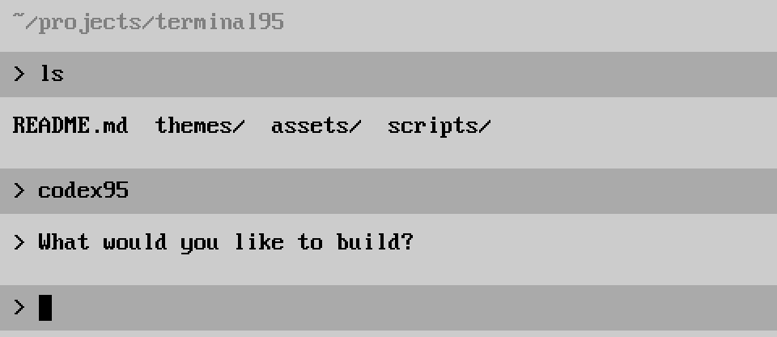

# Terminal95

A Windows 95-inspired terminal style: a gray background, black text, and a pixel console font. Use it with your usual shell and tools. A minimal Codex chat is included as an optional extra.

**Free and open source.** Download and use the style without an account, subscription, or license key.

**[Download the theme and font — ZIP](https://github.com/IgorBlink/terminal95/releases/latest/download/terminal95-theme.zip)**



*Rendered preview using the bundled font and theme.*

## Get the style

```sh
git clone https://github.com/IgorBlink/terminal95.git
cd terminal95
```

1. Install [PxPlus IBM VGA 8x16](assets/fonts/PxPlus_IBM_VGA_8x16.ttf), then select **PxPlus IBM VGA 8x16** in your terminal's font settings. On macOS or Windows, open the font file to install it. On Linux, copy it into `~/.local/share/fonts/` and run `fc-cache -f`.
2. Start at **16 pt**. Pixel fonts look best when the rendered size aligns with their original pixel grid; display scaling may require an adjustment.
3. Import or merge the matching profile below, then reload your terminal settings.

| Terminal | Profile | Apply |
| --- | --- | --- |
| Ghostty | [terminal95.ghostty](themes/terminal95.ghostty) | Add `config-file = /absolute/path/to/terminal95/themes/terminal95.ghostty` to your config. |
| Kitty | [terminal95.kitty.conf](themes/terminal95.kitty.conf) | Add `include /absolute/path/to/terminal95/themes/terminal95.kitty.conf` to `kitty.conf`. |
| Alacritty | [terminal95.alacritty.toml](themes/terminal95.alacritty.toml) | Add the file to your existing `[general]` import list. |
| WezTerm | [terminal95.wezterm.lua](themes/terminal95.wezterm.lua) | Merge the returned settings into your existing WezTerm config. |
| Windows Terminal | [terminal95.windows-terminal.json](themes/terminal95.windows-terminal.json) | Merge the scheme and font settings into `settings.json`; this is a settings snippet, not an extension fragment. |
| iTerm2 | [Terminal95.itermcolors](themes/Terminal95.itermcolors) | Import the color preset, then choose the font separately. |

The profiles change appearance only. See [profile instructions](themes/README.md) before merging into an existing configuration.

For another terminal, use this recipe:

| Setting | Value |
| --- | --- |
| Font | `PxPlus IBM VGA 8x16` |
| Starting font size | `16 pt` |
| Background | `#cccccc` |
| Foreground and cursor | `#000000` |
| Selection background | `#aaaaaa` |

The full classic 16-color palette is in [palette.json](themes/palette.json).

### Try the colors in the current terminal

```sh
sh scripts/theme.sh
sh scripts/theme.sh --reset
```

This uses terminal escape sequences to change the current terminal's colors. It requires a compatible terminal and does not change the font. There is no universal escape sequence for selecting a font, so use your terminal's font settings for the complete look. Terminal applications can also request their own colors.

## Optional: a minimal Codex chat

The style works without Python, Codex, or an OpenAI account. The optional `codex95` command provides a small chat using an installed, authenticated [Codex CLI](https://learn.chatgpt.com/docs/codex/cli).

The chat client is free too. The optional Codex connection uses your own account and is subject to [OpenAI's access, usage limits, and pricing](https://learn.chatgpt.com/docs/pricing).

On macOS or Linux, with Python 3.11+ and [uv](https://docs.astral.sh/uv/), install it from this repository:

```sh
uv tool install .
codex login
codex95
```

`pipx install .` is another option. If `codex95` is not on your PATH after a uv installation, run `uv tool update-shell` and reopen your shell.

```text
> hello
> Hi. What would you like to do?

>
```

The chat runs in the same terminal and working folder. Markdown headings, emphasis, lists, links, tables, and code render in the same simple monochrome style. Completed blocks appear as they arrive, with a small animated `> ...` indicator until the first visible text. Redirected output keeps the original Markdown. Reopening resumes the previous conversation without printing its old messages again.

| Key or command | Action |
| --- | --- |
| Enter | Send |
| Ctrl+J | Insert a newline |
| Ctrl+C | Stop a running answer; exit at the input prompt |
| Ctrl+D | Exit at an empty prompt |
| `/new` | Start a new conversation |
| `/sessions` | List saved sessions |
| `/resume 1` or `/resume SESSION_ID` | Open a session and show its transcript |
| `/reconnect` | Reconnect without replaying the transcript |
| `/exit` | Exit |

Use `codex95 --cwd /path/to/project` to choose another working folder, `--new` for a fresh conversation, or `--demo` for an explicitly marked offline demo. `--doctor` checks the local Codex connection. `CODEX95_CODEX_BINARY` can point to a CLI in a custom location.

The chat uses your existing Codex login and configured model, and starts Codex in its `read-only` sandbox. Codex owns authentication and conversation storage. Codex95 saves the last session ID per working directory in the platform's user data folder; set `CODEX95_STATE_DIR` to choose another location.

## Compatibility and development

The optional chat requires POSIX signal handling: macOS or Linux. It has been tested on macOS with Codex CLI `0.165.0-alpha.1.2`; native Windows chat is not supported. The terminal style is independent of the chat, including the Windows Terminal profile. Not every terminal or platform has been visually tested. The Codex app-server protocol can change between CLI releases.

```sh
uv sync
uv run pytest tests
```

See [CONTRIBUTING.md](CONTRIBUTING.md) for development notes and [SECURITY.md](SECURITY.md) for private reports.

## License and credits

Original code, profiles, and documentation are [MIT licensed](LICENSE). The unmodified **PxPlus IBM VGA 8x16** font is by **VileR**, from [The Ultimate Oldschool PC Font Pack](https://int10h.org/oldschool-pc-fonts/), and remains under **CC BY-SA 4.0**. Its [attribution](assets/fonts/ATTRIBUTION.txt) and [full license](assets/fonts/LICENSE-OldschoolPCFonts.txt) are included.

Terminal95 is an independent project, not affiliated with Microsoft or OpenAI.
